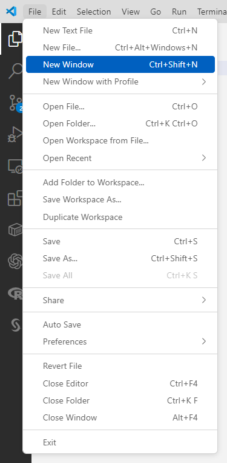
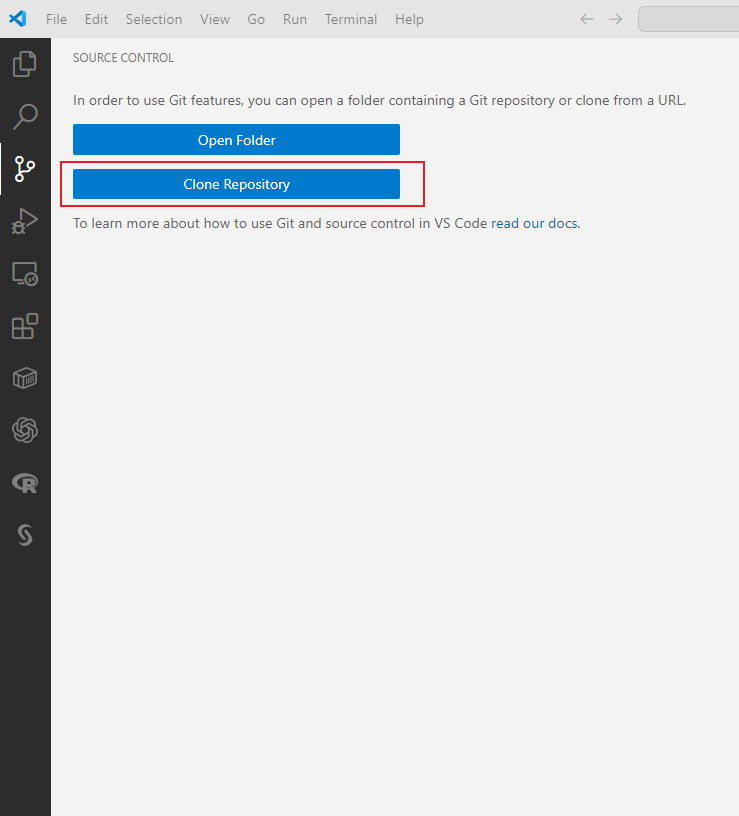
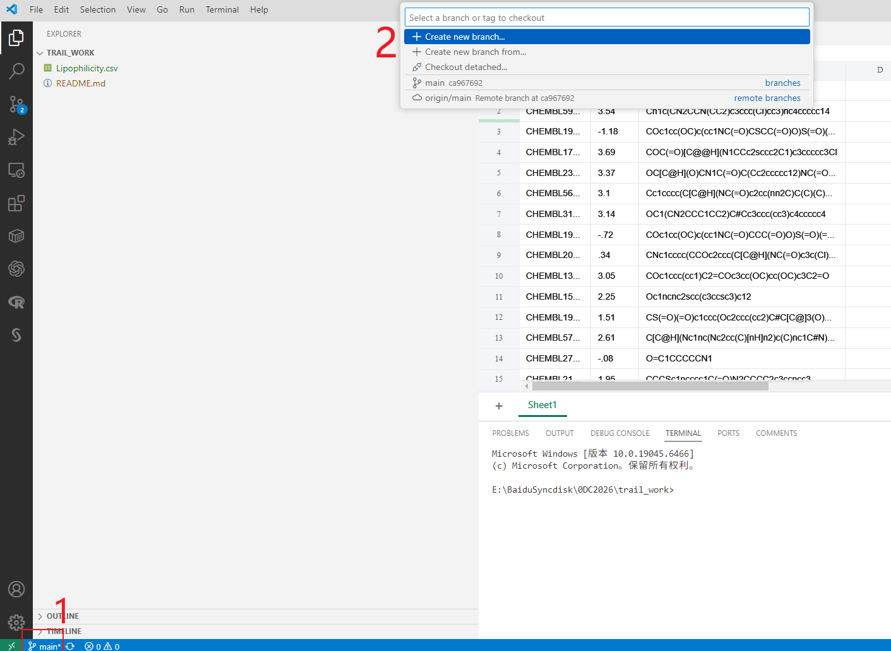
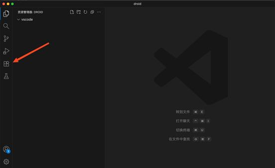
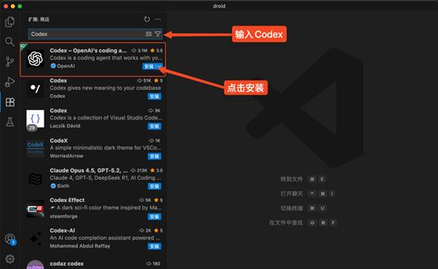
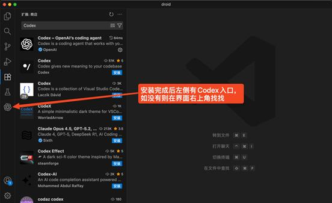
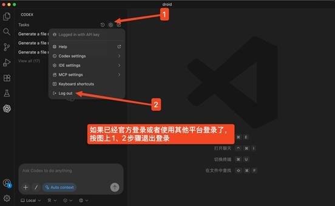
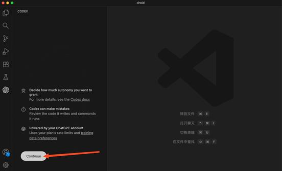
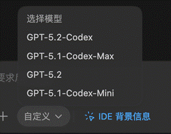
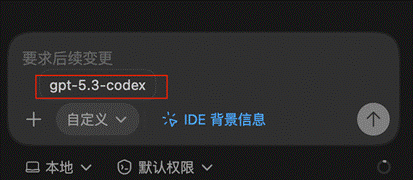

# A trail task

欢迎来到真实的药物筛选建模，从这份指南开始，你将尝试第一次去预测分子的的活性。

## 总则

1. 不要急于求成：对于初学者而言（如果你希望把每个步骤做到极致，对于有经验的研究者也是同样的）这是一个相当有挑战性的项目，并且我在其中埋下了一点坑-虽然遵照指南你可以轻易发现它们。所以你没有必要着急在一周内完成，而是慢慢的去探索、尝试。
2. 善用AI工具：我在教程中会专门教大家如何使用API配置CodeX，并在VScode中使用，大家可以充分利用它而不是手写代码，把更多精力、尝试放到如何准确的向CodeX提要求-也就是提示词工程，这其实是一项非常有技术的工作。同时请记住**你是代码的唯一担责主体**，AI只是你的工具，所以我会要求你在提交的`readme.md`手写一些内容，并对代码的真实性和可靠性做出承诺。在真实科研中，放任AI生成内容，非常容易造成严重的学术造假，所以请在第一次使用开始，提高警惕。不过面临大量代码，如何快速QA核查代码的真实性，希望听到你的方案。
3. 充分沟通交流：至少到目前，我们已经发现了三个可以沟通的点：我到底埋了什么坑、如何做良好的提示词工程、如何快速准确的核查代码。对于一个研究者/开发者而言，可选的分享、沟通的方式是多元的，你可以在组会的分享环节讲讲自己的实践和收获、可以在任意一个群或和任意一个人的私信里探讨、可以去我最近发的项目相关的朋友圈评论、也可以把你觉得不错的实践发到你的github，或者去我的github仓库：`https://github.com/Steven-Qu-04/`,找找有没有你感兴趣的项目，提交一个issue或者comment，并给我点一个star，我会非常感激。

## 准备你的工作环境

这永远是开始任何工作的第一步，在这里我默认你已经掌握基于conda的pytorch使用方式，如果你尚有疑问，请查看相关教程或直接提出。在这里，我会重点介绍一种新的写协作方式：git&github。

### 版本管理与git\github

相比你在写代码的时候，已经遇到过一个问题，你写好了一些代码，然后可能存在错误，或者你有新的想法，于是开始修改，但这个过程中，可能反而产生了更多的bug或者变得更加低效，于是你回天乏力，追悔莫及。而一个很聪明的办法，就是用好你的ctrl+c\ctrl+z，在一个新的副本上完成修改。这看起来似乎天衣无缝，但有一个问题-如果你同时有几种不同的想法，甚至更复杂的，你和你的朋友在尝试对同一段代码进行不同修改，然后还可能需要合并，该怎么办呢？

于是，一些天才的开发者想到了一个绝佳的方案，就是.git。简单来说，这就是一个特殊的软件，它的功能，就是当你在一个工作目录下安装了.git之后，它就会自动读取当前目录所有文件的状态，当你点击`commit`并输入一条commit massage，git就会把此时的时间、全部文件的内容、commit massage 全部存一次。这样，你就可以把任意一个文件回滚到commit过的任何一个状态，于是你只要记得及时commit，你就可以不用再创建副本，放心编辑。而你只需要把这个带commit的目录打包发给你的朋友，他的修改也会被git记录，当你们再把这两个git合并，你们就可以选择在不同的更改中保留哪个，形成新文件。

而github，就是把带有git的文件夹存在一个云端平台，这样你和你的朋友不需要把代码拷贝来拷贝去，直接往云盘同步，或者从云盘拉去他人的修改即可。

【【VScode与GitHub】10分钟学会用Git管理自己的代码】https://www.bilibili.com/video/BV1dK411p7RF?vd_source=cf2f65058ff6f4c195b663ba65c0586c

### 拉取你的作业仓库

这次的作业仓库在`https://github.com/Steven-Qu-04/trail_work`,理论上我已经把大家全部拉进collabrators了。先点一下我发在群上的邀请链接，然后在VScode里面拉仓库即可。





### 创建属于你的branch

**这很重要，如果你在main提交代码，请准备承接我的怒火（哈哈哈开个玩笑）**



先点左下角branch图标，再在上方弹出栏目里面选择create new branch即可，建议用自己姓名的拼音命名

### 配置CodeX

我给每个人都分配了一个密钥，请大家用自己的，另外请**严禁再提供给他人使用**，我后台看得到每个人的使用情况

•    **先编辑下配置文件（如果没有就新建，存在的话就覆盖）**

•    Mac/Linux 的在 ~/.codex/ 的目录下

•         创建或者覆盖配置文件 config.toml 和 auth.json 如果目录下已经有 config.toml 文件和  auth.json 文件就直接替换以下内容

•    如果没有 .codex 这个文件夹目录也可以使用终端命令创建文件夹：先执行 rm -rf ~/.codex 再执行 mkdir ~/.codex # 创建配置目录

 

•    Windows 的在 C:\users\你的用户名\.codex\ 的目录下

￮    创建或者覆盖配置文件 config.toml 和 auth.json 如果目录下已经有 config.toml 文件和 auth.json 文件就直接替换以下内容

￮    **注意：若之前使用官方或其他平台登录过，请先退出账号登录。再进行配置！**

•    config.toml直接粘贴或者覆盖为以下配置 

```json
model = "gpt-5.4"
model_reasoning_effort = "xhigh"
disable_response_storage = true
sandbox_mode = "danger-full-access"
windows_wsl_setup_acknowledged = true
approval_policy = "never"
profile = "auto-max"
file_opener = "vscode"
model_provider = "codex"
web_search = "cached"
suppress_unstable_features_warning = true

[history]
persistence = "save-all"

[tui]
notifications = true

[shell_environment_policy]
inherit = "all"
ignore_default_excludes = false

[sandbox_workspace_write]
network_access = true

[features]
plan_tool = true
apply_patch_freeform = true
view_image_tool = true
unified_exec = false
streamable_shell = false
rmcp_client = true
elevated_windows_sandbox = true

[profiles.auto-max]
approval_policy = "never"
sandbox_mode = "workspace-write"

[profiles.review]
approval_policy = "on-request"
sandbox_mode = "workspace-write"

[notice]
hide_gpt5_1_migration_prompt = true

[model_providers.codex]
name = "codex"
base_url = "https://gmncode.cn"
wire_api = "responses"
requires_openai_auth = true

```


•    auth.json 直接粘贴或者覆盖为以下配置 

 ```
 {
   "OPENAI_API_KEY": "这里填入在我们后台的你自己生成的KEY为sk-开头的密钥"
 }
 
 ```


**Visual Studio Code** **插件安装教程**

•    适合通过 VS Code 图形界面安装 Codex 插件的用户。

•    打开 VS Code 后先选择任意项目文件夹进入工作区。**不然会提示弹窗要求你打开项目文件夹！**

•    打开左侧插件扩展界面进入扩展面板。



1. 搜索 Codex，出现如图所示结果后点击安装。



2. 安装完成后侧栏会出现 Codex 入口。



3. 注意：若之前使用官方或其他平台登录过，请先按图退出登录。在进行重新配置！



4. 配置好后点卡就出出现当前界面，点击 Continue 完成登录流程。



5. 注意，5.3 的模型不会在下拉列表展示，鼠标移动到自定义可以看到当前正在使用的模型





## 开始任务！

**提示**

1.以下任务要点的顺序是我个人的思路，你可以不必按我列出的顺序尝试攻克，而是从你觉得容易、有信心或最有兴趣的开始。

2.下列要点其实多数都是真实研究中的难题，所以你的任务不是在每个要点或任何一个要点上得到一个完善的解决方案，而是尝试应用一下你所学到的知识，体验一下流程，感受一下研究的乐趣。

3.请在任意步骤善用AI以提升你的效率，但请时刻记住保持独立思考、主动捕获灵感，以及对AI生成内容的审慎和担责态度，你是AI pilot，不是 drove by AI。

4.再次欢迎和呼吁任何内容的友善交流，包括但不限于中午吃什么可以启发灵感（这一点我很需要哈哈哈哈哈）。

5.这对你来说会是一项很有意义的入门尝试，所以当你完成之后，你可以考虑把它fork到你的个人仓库，以免我误删。但在进行过程中，请将更改提交到我创建的这个仓库的你的branch里，这样我才能看到，以便交流。再次求star哈哈哈哈哈。

---

**任务内容**

你现在可以看到，在这个项目中，我已经准备了`Lipophilicity.csv`,该数据集介绍如下：

```text
Lipophilicity 是 MoleculeNet 中一个经典的分子性质预测数据集，任务是根据分子的结构信息预测其在 pH 7.4 条件下辛醇/水分配系数的对数值（logD）。这个指标常用来描述分子的亲脂性，数值越大通常表示分子越倾向进入脂相，因此它在药物发现中常被用来评估分子的吸收、分布和成药性。对初学者来说，可以把它理解为一个单任务回归问题：输入通常是分子的 SMILES 表示，输出是对应的 logD 数值标签。该数据集约包含 4200 个样本，推荐采用 scaffold split（骨架划分） 来划分训练集、验证集和测试集，并使用 RMSE 作为主要评估指标；这样更能检验模型对“新骨架分子”的泛化能力，而不只是记住训练集中的相似分子。刚开始使用时，建议先完成 SMILES 规范化、无效分子过滤和基础特征化（如分子指纹或图表示），再从线性回归、随机森林或简单图神经网络开始，逐步理解“分子结构如何影响脂溶性”的建模思路。
```

为了让这个任务更真实、可检验，我对仓库里的数据集其实进行过抽取和处理，**请务必仅使用这个提供的数据集完成任务，而不是尝试去另外获取、下载一个数据集。**

所以你的任务，就是基于这个数据集，构建一个能够从SMILES预测logD(exp字段)的模型，你可以考虑进行下列的研究和尝试：

1.这个数据集可用吗，在正式开始工作之前，是否需要进行一些必要的预处理和统计分析？注意不要忽略任何一列！

2.SMILES可以直接输入模型吗，是否需要进行一些处理，比如改变数据结构？增添一些信息？如果要进行，需要什么工具，这是一个CPU密集还是GPU密集任务，可以如何优化以缩短运行时间？

3.如果你觉得没有方向，或希望先跑通一次尝试，可以考虑下列思路：RDkit 分子描述符+线性回归/广义回归/随机森林。

4.除了分子的输入形式，模型的架构也会影响预测准确，什么样的架构是好的呢？

5.对于2，3问题，你所读到的文章是否有可以借鉴的点，不需要完全复现，你可以尝试从中选择输入方式或模型架构中的一个小点作为启发，构建一个简单的小模型。

6.模型训练也是一件技术活，你是如何选定和调节参数的，你的模型是否收敛到了稳定可用的状态呢？

7.你如验证你的模型的性能呢？

---

**交付要求**

1.你的branch中的全部代码，请务必保证这里包含了所有必须的代码，以运行你的模型并得出你声称的结果。

2.一个检验接口：我预留了一个带标签的数据集test.csv，它的字段与你手上的数据集完全一致，请你设计一个脚本，使得你的模型可以在获得这个数据集后完成推理，并对比推理结果和真实标签，输出你认为必要的检验报告。并在readme.md中声明如何完成这项工作。

3.`readme.md`仓库中的readme.md已经预制了一个模板，其中多数内容你可以让AI帮你填写，但是请务必明确两点：

- 你需要承诺AI所有填写的内容与你代码执行的过程和实现的功能完全一致
- readme.md中有一个强制手写板块，包括了承诺声明，请自己录入这些内容，如果有条件，请在仓库拍照上传一份手写签名的真实性承诺

4.请在整个任务中使用一个一致的conda环境，并在你的仓库中包含一份env.yml，记录你的环境，使得我可以复现运行你的代码。