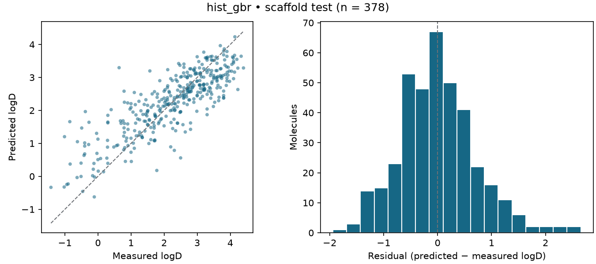

# 最佳 baseline 的 scaffold 测试集误差

模型 `hist_gbr` 由验证集 RMSE 选定。按化合物 ID 对齐已保存的测试集划分、预测和分子量，覆盖全部 378 个测试分子。每个分子权重相同。下列分析仅描述这一次留出集。

残差 = 预测 logD − 实测 logD，正值表示高估。RMSE 为 0.7144，MAE 为 0.5459，R² 为 0.6777。平均残差为 +0.0127，中位数为 -0.0015，第 10 至第 90 百分位为 -0.8103 至 +0.8946。绝对误差 ≤ 1 的有 317/378 个分子（83.9%）。

## 按实测 logD 分组

各表中 `[a, b)` 表示 a ≤ x < b。每组指标的分母是该组分子数。

| 区间 | 分子数 | 平均残差 | MAE | RMSE |
|---|---:|---:|---:|---:|
| `[-inf, 0.0)` | 27 | 1.0287 | 1.0667 | 1.2629 |
| `[0.0, 1.0)` | 36 | 0.7218 | 0.7445 | 0.9492 |
| `[1.0, 2.0)` | 74 | 0.2469 | 0.4575 | 0.5969 |
| `[2.0, 3.0)` | 116 | -0.0510 | 0.3960 | 0.5343 |
| `[3.0, 4.0)` | 110 | -0.4557 | 0.5419 | 0.6573 |
| `[4.0, inf)` | 15 | -0.7456 | 0.7578 | 0.8340 |

## 按分子量分组

分子量取自训练时缓存的 RDKit `MolWt` 描述符，单位为 Da。

| 区间 | 分子数 | 平均残差 | MAE | RMSE |
|---|---:|---:|---:|---:|
| `[-inf, 300.0)` | 89 | -0.1245 | 0.6175 | 0.7769 |
| `[300.0, 400.0)` | 123 | 0.0774 | 0.5273 | 0.7006 |
| `[400.0, 500.0)` | 123 | 0.0346 | 0.5269 | 0.6899 |
| `[500.0, inf)` | 43 | 0.0491 | 0.5058 | 0.6872 |

## 按骨架分组

测试集含 377 个非空 Bemis–Murcko 骨架。另有 1 个无环分子，沿用划分规则，逐个成组。共 378 组，其中 378 组只有一个分子。单分子组的 MAE 和 RMSE 都等于这一分子的绝对误差，无法估计骨架内的波动或判断哪类骨架更难预测。

[全部骨架组的样本数、平均残差、MAE 和 RMSE](by_scaffold.csv)

在项目目录运行 `python analyze_errors.py` 可从已保存的预测重新生成此报告。
